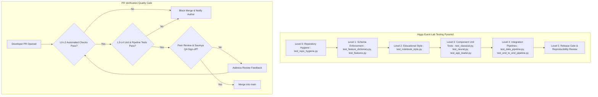

# QA and Test Plan

> **Owner:** Saumya Mishra (END-04, MID-07). **Companion files:** `team/BUG_TRACKER.md`, `team/CHANGELOG.md`, `tests/`.
> **Principle:** Saumya coordinates and verifies; module owners write and fix the tests and code for their own modules (`team/TEAM_CHARTER.md`).
> **Verification status (2026-11-14):** fresh-clone installation and the full suite passed locally on Python 3.15.1 (143 passed); GitHub Actions also passed on Python 3.11. Docker build, real-data smoke test, independent retraining and the neural release decision remain outstanding.

---

## 1. Test levels



| Level | What | Where | Run by |
|---|---|---|---|
| L0 Repository hygiene | Files exist, no data or secrets, links work, no unsourced metrics | `tests/unit/test_repo_hygiene.py` | Everyone before each PR |
| L1 Schema | Feature dictionary and column order | `tests/unit/test_feature_dictionary.py` | Everyone |
| L2 Notebook readability | Markdown explanations, comment-free, short code cells | `tests/unit/test_notebook_style.py` | Everyone |
| L3 Raw data | 29 columns, labels, no NaN, class mix | `tests/integration/smoke_check_raw_file.py` | Aditya, Saumya (on every data change) |
| L4 Unit tests of project code | Loader, features, splits, metrics, artifacts | `tests/unit/` (added by owners) | Module owners |
| L5 Integration | Tiny synthetic data through the whole flow and into the dashboard | `tests/integration/` | Krishna, Saumya |
| L6 Reproducibility review | Fresh clone, follow the setup guide, compare outputs | manual (section 5) | Saumya |
| L7 Release gate | Final checks before deployment | manual (section 7) | Saumya signs, Krishna decides |

Synthetic data are for testing code paths only and must never be presented as HIGGS results (`tests/README.md`).

---

## 2. How to run what exists

```bash
python -m pytest tests/ -v
python tests/integration/smoke_check_raw_file.py data/raw/HIGGS.csv.gz --rows 100000
```

### 2.1 Test log (real results; update at every QA run)

| Date | Command | Result | Notes |
|---|---|---|---|
| 2026-10-21 | `pytest tests/unit` on the original uploaded scaffold plus new files | Two failures found and fixed: placeholder citation author, changelog layout | See BUG-004 |
| 2026-10-21 | `pytest tests/unit` after fixes | **26 passed, 0 failed** | Initial sweep of the delivered repository |
| 2026-10-25 | `pytest` full test suite after classical, neural, dashboard, protocol modules | **103 passed, 0 failed** in ~6.4s | All unit and integration tests passing cleanly |
| 2026-10-25 | Negative controls: copy of the repo with injected faults (a fake ROC-AUC claim in a report, an empty `HIGGS.csv.gz`, a fake API key in `app/config.py`, a `#` comment in a notebook code cell) | 4 tests failed as intended, 22 passed | Shows the guards detect what they are meant to detect |
| 2026-10-26 | Final-push review: `pytest` on 14 non-PyTorch test files (hygiene, notebook style, feature dictionary, protocol, features, data loader, evaluation, download, classical, dashboard loader/metrics/views, data pipeline integration) | **98 passed, 1 failed.** The failure is `test_app_views.py::test_bootstrap_cloud_artifacts_if_needed`, caused by `ModuleNotFoundError: streamlit` in the review environment (dependency missing, not a code fault). | BUG-022. Install `requirements.txt` and rerun. **NOT RUN here:** `test_neural.py` (3 tests) and `test_end_to_end_pipeline.py` (2 tests) need PyTorch; `smoke_check_raw_file.py` on the real HIGGS file. Run them on the team machine and paste output here. |
| 2026-10-26 | Results consistency check (not a test): compared `outputs/*/metrics.json`, `outputs/experiments.json` and `outputs/full_colab_results.json` | **Inconsistent.** 250k MLP all-features ROC-AUC 0.9406 vs 1M wide MLP 0.8399; every model family is lower at 1M | BUG-015, BUG-016, BUG-017, BUG-018. See `docs/14_RESULTS_RECONCILIATION.md` | <!-- allow-metric -->
| 2026-11-14 | Fresh-clone QA on macOS arm64: `MPLBACKEND=Agg python -m pytest -q` after `python -m pip install -e ".[dev]"` in a new `.venv` | **143 passed, 0 failed** in 80.52s | Fresh clone succeeded; dependency installation completed after transient package-index timeouts and automatic retries. Python 3.15.1. No dataset download or model retraining was performed. |

---

## 3. Checklists for reviewing teammates' contributions

Use the matching list when a PR from that person arrives. Tick each item, paste evidence (command and real output) in the PR, and raise a bug for any failure. Where an item needs code to exist, it is marked *(when code lands)*.

### 3.1 Aditya Rana: data pipeline, EDA, classical ML (MID-01, 02, 03; END-01)

- [ ] Data source is the official UCI URL and the PR records retrieval date, file name and checksum.
- [ ] Loader reads in chunks; it never loads all 11 million rows to demonstrate the pipeline.
- [ ] Loader output has exactly 28 feature columns whose names and order equal `docs/feature_dictionary.csv`; label is a separate vector with values 0 and 1 only.
- [ ] Off-by-one check: `low_level` is 21 columns, `high_level` is 7, `all` is 28.
- [ ] Sampling rule and seed are written down; class fraction of the sample is printed.
- [ ] Split happens before any scaler or imputer is fitted; scaler fitted on train only (test with a toy set).
- [ ] Same split indices are saved and reused by every model.
- [ ] Logistic Regression and XGBoost settings (including trees, depth, learning rate, early stopping) are recorded; tuning used validation only.
- [ ] Metrics: ROC-AUC, average precision, Brier or calibration, training time, all read from a saved file, not typed by hand.
- [ ] EDA figures are generated from the actual sample and have axis labels, units where relevant, and a one-line interpretation in Markdown.
- [ ] EDA confirms or corrects the open assumptions in `docs/09` section 4 (BUG-014) and BUG-006.
- [ ] Unit tests exist for: unexpected columns, label leakage, wrong row counts.
- [ ] No data, `.parquet`, `.pkl` or large outputs staged.

### 3.2 Rachit Gupta: MLP and reproducibility (MID-04, END-02)

- [ ] Uses the same split indices, feature groups and metrics as the classical models.
- [ ] Architecture includes batch normalization and dropout, and is "compact" (record layer sizes and parameter count).
- [ ] `model.eval()` and `torch.no_grad()` are used for validation and test inference (watch item W-07).
- [ ] Preprocessing fitted on train only; early stopping and hyperparameters selected on validation only.
- [ ] Seeds set for Python, NumPy and PyTorch; device, epochs, batch size, learning rate, early-stopping patience, training time recorded.
- [ ] Re-running with the same seed reproduces the metrics within a stated tolerance (CPU) or the nondeterminism is documented (GPU).
- [ ] Predictions saved in the agreed artifact schema.
- [ ] Tests for tensor shapes and target dtype/handling.
- [ ] Comparison to classical models uses the same test rows and reports spread over seeds where available.

### 3.3 Krishna: protocol, evaluation, artifacts, integration, deployment (MID-05, END-03, END-06, END-07)

- [ ] One documented artifact schema exists, accepted by Aditya, Rachit and Ronit before dashboard work (MID-05).
- [ ] Split, metric and seed protocol is written as an ADR and matches `docs/10` (resolves BUG-011).
- [ ] Metric functions have unit tests including edge cases (single class, ties, all-one predictions).
- [ ] Operating threshold is computed from validation data only; test results are reported at the frozen threshold (W-05).
- [ ] Every number in the report traces to a saved artifact file and run ID.
- [ ] Deployment: smoke test passes, no secrets tracked, limitation statement visible, rollback tested and written down.
- [ ] Released version is tagged and `CHANGELOG.md` entry exists.

### 3.4 Ronit Singh: dashboard (MID-06, END-05)

- [ ] Starting the app does not train a model and finishes quickly.
- [ ] With an empty `outputs/` folder the app shows a clear empty-state instruction and no numbers (W-09).
- [ ] A malformed or incompatible artifact produces a readable error, not a stack trace or silent wrong data (W-10).
- [ ] Every chart shows data source, event count, split, feature group and model metadata.
- [ ] Validation-selected threshold is visibly distinguished from test evaluation.
- [ ] The simulated-data limitation statement is visible on the main view.
- [ ] No hard-coded scores; any mock data is labelled **MOCK** and excluded from submitted material.
- [ ] Export contains the metric table plus experiment metadata.
- [ ] Screenshots or a described UI behaviour are attached to the PR.
- [ ] Basic usability test with one person who has not seen the app: can they find the best model and the data source in under two minutes?

### 3.5 Saumya's own documentation (reviewed by Krishna and Ronit)

- [x] Dataset scope and feature groups reviewed against the technical methodology contribution and existing UCI references.
- [x] Unresolved experiment claims remain explicitly provisional; remaining author metadata is not guessed.
- [ ] Setup guide commands are run on a clean clone (section 5) after every code change.
- [ ] Ronit confirms the documents are readable by a non-physicist.

---

## 4. Notebook explanation and readability checklist (agreed style from `CONTRIBUTING.md`)

**Automated** (`test_notebook_style.py`): first cell is Markdown; each code cell has a Markdown cell before it with at least 25 words; no `#` comments in code cells; code cells at most 40 lines; outputs under 20,000 characters.

**Manual**, per major section:

- [ ] States the **question** the section answers.
- [ ] States **why** the step is needed.
- [ ] States **what the code will do**.
- [ ] States the **expected output**.
- [ ] Gives an **interpretation** and a "what could go wrong" note.
- [ ] Uses plain language; every new term is defined on first use or links to `docs/08` glossary.
- [ ] Plots have titles, axis labels, units and a legend; colours are distinguishable (not only red versus green).
- [ ] Source, row count, seed, split, package versions, model settings and runtime are printed once near the top.
- [ ] Logic reused across notebooks lives in `src/higgs_event_lab/`, not copy-pasted.
- [ ] "Restart kernel and run all" succeeds from top to bottom.
- [ ] No placeholder scores, no unrun result text, no absolute local paths.

---

## 5. Reproducibility review (L6)

Performed by Saumya on a clean clone, using only the written instructions.

1. Clone the repository into a new empty folder.
2. Follow `docs/11_SETUP_GUIDE.md` literally; write down every step that needed outside knowledge.
3. Run L0 to L3 tests; record pass or fail.
4. Run the starter experiment with the documented seed; compare saved metrics with the author's within the stated tolerance.
5. Open a bug for every step that failed or was unclear; update the guide.
6. Record the result in the test log (section 2.1).

Pass condition: a person who was not involved can reproduce the starter run without asking anyone.

---

## 6. Wording and claims review

Search the report, README, notebooks and dashboard text for the following and fix every hit.

| Search for | Problem | Replace with |
|---|---|---|
| "discover", "detect the Higgs", "found the Higgs" | Implies a real discovery | "classify simulated signal and background events" |
| "probability of being a Higgs" | Scores are not physical probabilities | "classifier score" |
| "significance", "sigma" | Not computed in this project | Remove, or state explicitly that it is out of scope |
| "state of the art", "outperforms the paper" | Unsupported comparison with different protocol | Compare only with runs from our own pipeline |
| "accuracy" without ROC-AUC / PR-AUC | Insufficient metric | Add the required metrics |
| Any number for ROC-AUC, PR-AUC, accuracy | Must come from a saved artifact | Cite run ID and file |
| "real data", "detector" | The data are simulated | "simulated events" |

The test `test_no_unsourced_metric_numbers_in_docs_and_reports` automatically flags metric-looking numbers in `docs/`, `reports/` and `team/` Markdown. Lines that legitimately contain such a number (for example a definition) can carry the marker `<!-- allow-metric -->`.

---

## 7. Release gate verification (from `docs/05`)

Saumya signs off only when every box is ticked. Any unticked box blocks documentation sign-off and is reported to Krishna.

- [ ] No fabricated or mismatched metrics (every table cell traced to an artifact).
- [ ] No known data leakage (W-01 to W-05 tests present and passing).
- [ ] Data source documented, with retrieval date, row count and checksum.
- [ ] Artifact loading works from a clean clone.
- [ ] No secrets and no raw data in the repository or its history (`git log --stat` spot-check).
- [ ] No wording that claims a real discovery (section 6).
- [ ] Limitations section present in the report and visible in the app.
- [ ] Setup guide verified on a clean clone.
- [ ] `team/CHANGELOG.md` and `team/BUG_TRACKER.md` up to date; open P0/P1 neural evidence is documented for Krishna's decision.
- [ ] Citations present: UCI dataset, Baldi et al. 2014, and any physics sources.

---

## 8. Roles summary

| Activity | Saumya | Module owner |
|---|---|---|
| Write unit tests for the code | Reviews | Writes |
| Reproduce a reported bug | Does | Assists |
| Fix a root cause | Only docs, tests, packaging, low-risk cross-cutting | Fixes |
| Verify the fix | Does | Confirms |
| Update changelog and known issues | Does | Supplies details in PR |
| Release decision | Reports status | Krishna decides |


## Issue #21 local verification — 2026-11-13

- Full suite: `python -m pytest -q` — **143 passed** using Python 3.13.
- Editable package build and installation succeeded in a temporary virtual environment
  with existing system packages, using `pip install --no-deps --no-build-isolation -e ".[dev]"`.
  This verifies editable packaging, not a fresh network dependency resolution.
- Streamlit AppTest rendered all seven dashboard sections against the nine saved
  canonical run packages without exceptions. No browser screenshots were taken.
- Recomputed test metrics from each saved prediction file matched the recorded metrics
  to numerical precision. This checks internal consistency, not independent training provenance.
- Regression coverage includes empty, malformed, mixed and valid runs; duplicate IDs;
  prediction counts and invalid values; malformed EDA; multiple-run comparison;
  legacy loader delegation; and startup without generated results.
- Saved output artifacts were not modified.
- Not run: Docker build, hosted CI, fresh network installation or independent retraining.
  Saumya clean-clone QA and Krishna integration review remain pending.

## Issue #20 documentation integration — 2026-11-14

- Reviewed the merged technical methodology contribution and integrated its scientific scope, feature-group rationale, model-family rationale, split protocol and metric definitions into the report draft.
- Corrected the 250k Logistic Regression placeholder values using the T4 clean-rerun evidence in `docs/14_RESULTS_RECONCILIATION.md`; kept the 250k and 1M experiments separate.
- Neural benchmark values remain provisional pending the neural reproducibility and cross-pipeline release decision.
- Updated setup, report, changelog, bug register, citation metadata and task backlog.

## Clean-clone and hosted CI verification — 2026-11-14

- **Local fresh clone:** `git clone https://github.com/Saumya-Mishra-536/Higgs_Boson_Capstone.git Higgs_Boson_QA` succeeded on macOS arm64.
- **Environment:** new Python 3.15.1 virtual environment; `python -m pip install --upgrade pip` succeeded.
- **Fresh dependency installation:** `python -m pip install -e ".[dev]"` succeeded. Several package downloads required automatic retries after transient network timeouts; installation completed successfully.
- **Full suite:** `MPLBACKEND=Agg python -m pytest -q` — **143 passed** in 80.52s.
- **Hosted CI:** GitHub Actions run [#26](https://github.com/Saumya-Mishra-536/Higgs_Boson_Capstone/actions/runs/43561124032) on commit `85456546e67e5ccbcb5243f7d3ca40719d5e102e` passed checkout, Python 3.11 setup, `python -m pip install -e ".[dev]"` and `python -m pytest -q`.
- The 2026-11-13 Streamlit AppTest and artifact-consistency checks remain recorded above. No browser screenshots were taken.
- **Not run:** Docker build, real HIGGS raw-file smoke test, independent model retraining, and a full interactive browser review. The clean-clone test verifies installation and automated tests; it does not independently reproduce benchmark metrics.
- **Scientific wording sweep:** reviewed the README, core scientific/setup/protocol docs, report sources, notebooks and key dashboard views for discovery, probability, significance, detector and class-rate wording. Corrected stale classical metrics, unsupported collider-rate estimates, the simulated-process label, score terminology and provisional neural interpretations. This was a broad targeted review, not an exhaustive line-by-line scan of every repository file; W-12 remains open.
- **Generated binaries:** the report Markdown and presentation Markdown sources were updated, but the tracked HTML/PDF report and PPTX deck were not regenerated in this environment. Rebuild and review those rendered deliverables before final submission.
