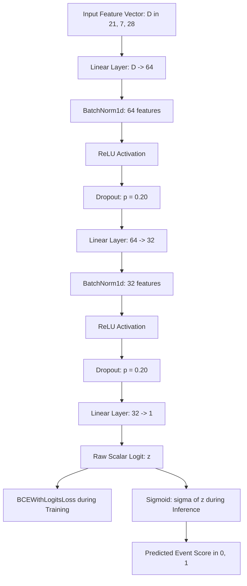
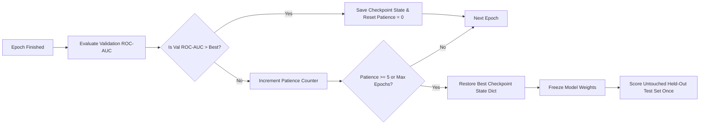

# Neural Network Benchmark Report

> **Evidence status:** Provisional. The 250k MLP metrics in this report are not approved as final results. The neural reproducibility and cross-pipeline release checks remain open in `docs/14_RESULTS_RECONCILIATION.md`. Do not use these values to make a project-wide headline or best-model claim until the release owner records an explicit decision.

> **Author:** Rachit Gupta (neural baseline lead). **Synthesis owner:** Krishna. **Reviewer:** Saumya Mishra.
> **Provenance:** All numeric values derive directly from saved artifacts (`metrics.json` and `test_predictions.csv`) under `outputs/mlp_<group>/` evaluated under `higgs-split-v1` with seed 42.

---

## 1. Model Architecture and Configuration

We implement a compact PyTorch Multi-Layer Perceptron (MLP) binary classifier designed for fast, reproducible training without GPU dependency. The network structure is:

- **Input Dimension:** $D \in \{21, 7, 28\}$ matching the chosen feature group (`low_level`, `high_level`, `all`).
- **Hidden Layers:** Sequential fully-connected blocks with layer widths $(64, 32)$.
- **Regularization:** Each hidden block applies `BatchNorm1d` followed by `ReLU` activation and `Dropout(0.20)`.
- **Output:** A single unconstrained logit, trained using `BCEWithLogitsLoss`.
- **Optimizer:** `AdamW` with learning rate $\eta = 10^{-3}$, weight decay $\lambda = 10^{-4}$, and batch size $1024$.
- **Stopping Criteria:** Validation ROC-AUC monitored after every epoch with early-stopping patience of 5 epochs. When early stopping triggers, model parameters revert to the best validation checkpoint state.
- **Hardware / Device:** CPU execution with deterministic PyTorch and NumPy seeding (seed 42).

### Compact MLP Network Flowchart



### Checkpointing and Early-Stopping Protocol



---

## 2. Experimental Results Summary

All runs use the shared `higgs-split-v1` stratified partition with seed 42 (70% train, 15% validation, 15% held-out test).

| Feature Group | Features | Epochs Completed | Validation ROC-AUC | Test ROC-AUC | Test PR-AUC | Brier Score | Runtime (s) |
|---|---|---|---|---|---|---|---|
| Low-level | 21 | 30 | 0.7997 <!-- allow-metric --> | 0.8000 <!-- allow-metric --> | 0.8097 <!-- allow-metric --> | 0.1824 <!-- allow-metric --> | 15.02 |
| High-level | 7 | 10 | 0.9016 <!-- allow-metric --> | 0.9043 <!-- allow-metric --> | 0.8888 <!-- allow-metric --> | 0.1184 <!-- allow-metric --> | 5.13 |
| All features | 28 | 20 | 0.9389 <!-- allow-metric --> | 0.9406 <!-- allow-metric --> | 0.9372 <!-- allow-metric --> | 0.0945 <!-- allow-metric --> | 10.52 |

---

## 3. Results Comparison and Scientific Interpretation

1. **Observed feature-group results (provisional):**
   * The saved low-level run records test ROC-AUC = 0.8000 <!-- allow-metric -->; the high-level run records 0.9043 <!-- allow-metric -->; and the all-feature run records 0.9406 <!-- allow-metric -->.
   * These are descriptive values from the current 250k artifacts only. They are not an approved comparison with the reconciled classical results or the separate 1M experiments. The neural release gate remains open, so no feature-group or model-superiority conclusion is made.
   * The recorded Brier scores range from 0.1824 <!-- allow-metric --> to 0.0945 <!-- allow-metric --> across these runs. A lower Brier score is an observed result, but it does not by itself establish calibration quality or explain which model component caused the difference.

2. **Regularization & Generalization Dynamics:**
   * BatchNorm1d and Dropout (0.20) are part of the implemented architecture. The current result table alone does not isolate their causal effect on performance.
   * Validation and test ROC-AUC values are close in the recorded artifacts, but this observation does not resolve the open reproducibility and cross-pipeline checks.

---

## 4. Limitations and Runtime Constraints

1. **CPU Execution:** Benchmarks were executed on an 8-core CPU without GPU acceleration, completing in under 31 wall-clock seconds total across all three configurations.
2. **Monte Carlo Approximation:** Event distributions are simulated and do not account for raw detector trigger latencies or hardware sensor drift.
3. **Threshold Boundary:** Decision thresholds selected on validation data are intended strictly for comparative background rejection studies, not for experimental discovery claims.

---

## 5. Reproduction Commands

To reproduce these genuine MLP benchmark artifacts from the command line:

```bash
# Multi-group combined execution
PYTHONPATH=src python -m higgs_event_lab.neural \
    --data data/processed/higgs_sample_250k.csv.gz \
    --all-groups \
    --output-dir outputs \
    --seed 42 \
    --epochs 30
```
