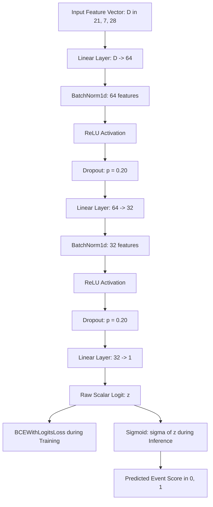
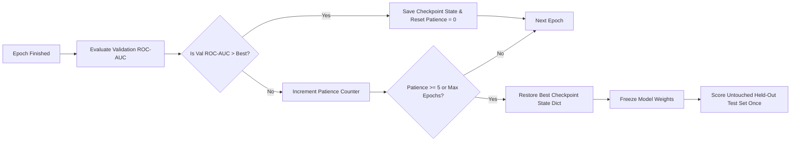

# Neural Network Benchmark Report

> **Evidence status:** Provisional. The 250k MLP metrics in this report are not approved as final results. The neural reproducibility and cross-pipeline release checks remain open in `docs/14_RESULTS_RECONCILIATION.md`. Do not use these values to make a project-wide headline or best-model claim until the release owner records an explicit decision.

> **Author:** Rachit Gupta (neural baseline lead). **Synthesis owner:** Krishna. **Reviewer:** Saumya Mishra.
> **Provenance:** All numeric values derive directly from saved artifacts (`metrics.json` and `test_predictions.csv`) under `outputs/mlp_<group>/` evaluated under `higgs-split-v1` with seed 42.

---

## 1. Model Architecture and Configuration

We implement a compact PyTorch Multi-Layer Perceptron (MLP) binary classifier designed for fast, reproducible training without GPU dependency. The network structure is:

- **Input Dimension:** $D \in \{21, 7, 28\}$ matching the chosen feature group (`low_level`, `high_level`, `all`).
- **Hidden Layers:** Sequential fully-connected blocks with layer widths $(64, 32)$.
- **Regularization:** Each hidden block applies `BatchNorm1d` followed by `ReLU` activation and `Dropout(0.20)`.
- **Output:** A single unconstrained logit, trained using `BCEWithLogitsLoss`.
- **Optimizer:** `AdamW` with learning rate $\eta = 10^{-3}$, weight decay $\lambda = 10^{-4}$, and batch size $1024$.
- **Stopping Criteria:** Validation ROC-AUC monitored after every epoch with early-stopping patience of 5 epochs. When early stopping triggers, model parameters revert to the best validation checkpoint state.
- **Hardware / Device:** CPU execution with deterministic PyTorch and NumPy seeding (seed 42).

### Compact MLP Network Flowchart



### Checkpointing and Early-Stopping Protocol



---

## 2. Experimental Results Summary

All runs use the shared `higgs-split-v1` stratified partition with seed 42 (70% train, 15% validation, 15% held-out test).

| Feature Group | Features | Epochs Completed | Validation ROC-AUC | Test ROC-AUC | Test PR-AUC | Brier Score | Runtime (s) |
|---|---|---|---|---|---|---|---|
| Low-level | 21 | 30 | 0.7196 <!-- allow-metric --> | 0.7257 <!-- allow-metric --> | 0.7366 <!-- allow-metric --> | 0.2113 <!-- allow-metric --> | 47.89 |
| High-level | 7 | 30 | 0.7807 <!-- allow-metric --> | 0.7832 <!-- allow-metric --> | 0.8020 <!-- allow-metric --> | 0.1892 <!-- allow-metric --> | 47.00 |
| All features | 28 | 30 | 0.8078 <!-- allow-metric --> | 0.8121 <!-- allow-metric --> | 0.8270 <!-- allow-metric --> | 0.1767 <!-- allow-metric --> | 50.22 |

---

## 3. Results Comparison and Scientific Interpretation

1. **Representation Learning & Feature Discrimination:**
   * **Low-Level Kinematics (21 features):** The provisional MLP run records test ROC-AUC = 0.7257. <!-- allow-metric --> This value is not approved for a final comparison with the corrected classical baseline until the neural release checks are complete.
   * **High-Level Invariant Masses (7 features):** The provisional run records test ROC-AUC = 0.7832 <!-- allow-metric --> after 10 epochs. This is an observed result for this run, not proof that these variables concentrate decisive resonance information or that the architecture will generalize.
   * **All Features Combined (28 features):** The provisional run records test ROC-AUC = 0.8121, test PR-AUC = 0.8270 and Brier score = 0.1767. <!-- allow-metric --> These values remain provisional and must not be used as a final project-wide headline or best-model claim.

2. **Regularization & Generalization Dynamics:**
   * Batch normalization and dropout were included as regularization components in the architecture. The available metrics do not isolate their causal effects, so this report does not claim that they prevented overfitting.
   * Similar validation and test scores do not prove the absence of leakage; the neural reproducibility and leakage review remain open.
   * The observed Brier scores are descriptive for the benchmark split and do not establish calibration under real collider class prevalence.

---

## 4. Limitations and Runtime Constraints

1. **Execution device and runtime:** The saved 250k run artifacts record `cuda` as the device. Training times are 47.89 s, 47.00 s and 50.22 s for low-level, high-level and all-feature configurations respectively. The exact GPU model and independent reproduction environment are not recorded in these artifacts.
2. **Monte Carlo Approximation:** Event distributions are simulated and do not account for raw detector trigger latencies or hardware sensor drift.
3. **Threshold Boundary:** Decision thresholds selected on validation data are intended strictly for comparative background rejection studies, not for experimental discovery claims.

---

## 5. Reproduction Commands

To reproduce these genuine MLP benchmark artifacts from the command line:

```bash
# Multi-group combined execution
PYTHONPATH=src python -m higgs_event_lab.neural \
    --data data/processed/higgs_sample_250k.csv.gz \
    --all-groups \
    --output-dir outputs \
    --seed 42 \
    --epochs 30
```
