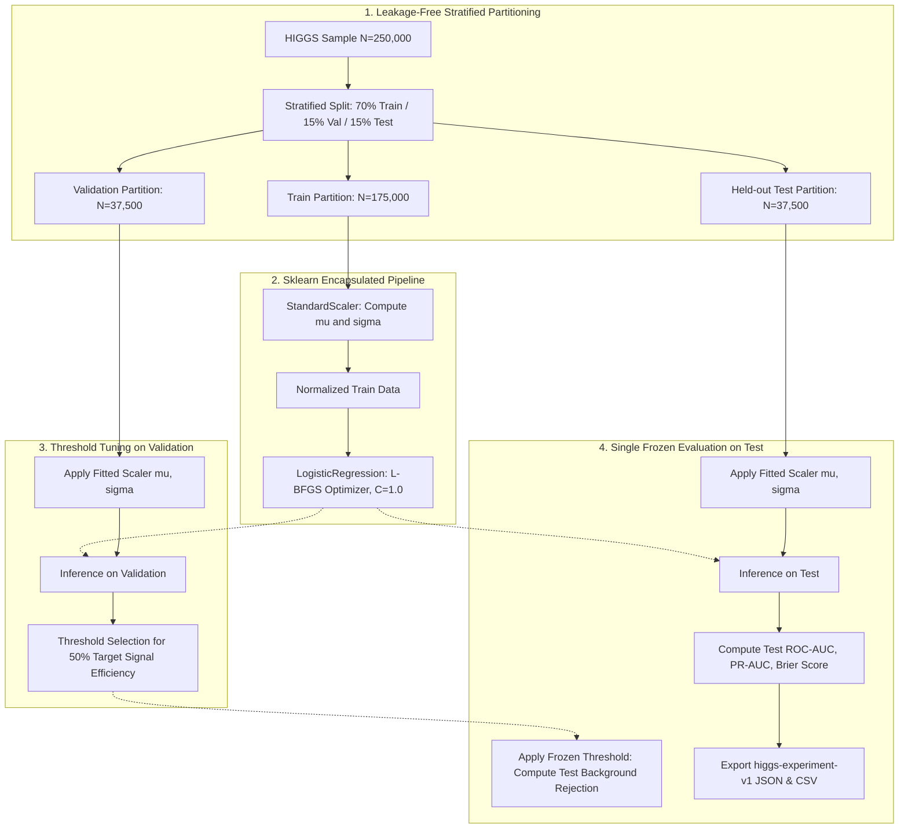

# Classical Logistic Regression Baseline Report

> **Author:** Aditya Rana (classical baseline & data lead). **Synthesis owner:** Krishna. **Reviewer:** Rachit Gupta.
> **Provenance:** Numeric values derive directly from saved artifacts (`metrics.json` and `test_predictions.csv`) under `outputs/logreg_<group>/` generated under the `higgs-split-v1` protocol with seed 42.

---

## 1. Model Configuration and Preprocessing Pipeline

We implement regularized Logistic Regression baselines using `scikit-learn` to establish linear decision boundary benchmarks across feature groups:

- **Input Dimension:** $D \in \{21, 7, 28\}$ matching `low_level`, `high_level`, and `all` feature groups.
- **Preprocessing:** `StandardScaler` embedded within an `sklearn.pipeline.Pipeline` to guarantee that scalers are fitted strictly on the training partition without test or validation leakage.
- **Solver & Regularization:** L-BFGS solver with inverse regularization strength $C = 1.0$ and tolerance $10^{-4}$.
- **Decision Threshold:** Operating threshold selected strictly on the validation partition targeting $50\%$ signal efficiency, then frozen and evaluated on the held-out test partition.

### Pipeline Architecture Diagram



---

## 2. Reconciled Logistic Regression Results

The original 250k all-features Logistic Regression value of 0.8369 was fabricated placeholder data. The clean rerun records the following test ROC-AUC values. Other metrics for the clean rerun are not stated here because the closure record does not provide them.

| Sample | Feature group | Features | Test ROC-AUC | Evidence |
|---|---|---:|---:|---|
| 250k | Low-level | 21 | 0.5960 <!-- allow-metric --> | Reconciliation T4 |
| 250k | High-level | 7 | 0.6518 <!-- allow-metric --> | Reconciliation T4 |
| 250k | All features | 28 | 0.6854 <!-- allow-metric --> | Reconciliation T4 |
| 1M | All features | 28 | 0.6834 <!-- allow-metric --> | Reconciled 1M artifact |

The historical values below are not reproduced. Use the reconciliation record and serialized run artifacts for any additional metric or configuration detail.

### Additional feature-group and coefficient observations

1. **Feature Group Discrimination:**
   * In the clean 250k rerun, the all-features model has test ROC-AUC 0.6854, compared with 0.6518 for high-level and 0.5960 for low-level features. <!-- allow-metric -->
   * The 1M all-features result is 0.6834, close to the clean 250k result. These values support a consistent linear baseline across the two sample sizes.

2. **Leakage Protection and Pipeline Encapsulation:**
   * Embedding feature standardisation within an `sklearn.pipeline.Pipeline` ensures that scaling parameters are fitted on training data only.
   * Validation-only threshold selection keeps operating-point selection separate from held-out test evaluation.

3. **Compute Efficiency Trade-Off:**
   * The 1M reconciliation records a Logistic Regression training time of 2.6 seconds. Do not transfer historical 250k timing values to the clean rerun.

## 3. Key Observations and Discussion

1. **Feature Group Discrimination:**
   * In the clean 250k rerun, test ROC-AUC is 0.5960 for low-level features, 0.6518 for high-level features, and 0.6854 for all features. <!-- allow-metric --> The 1M all-feature result is 0.6834. <!-- allow-metric --> These are the reconciled values; the earlier 0.7661 and 0.7476 discussion figures are not supported by the current clean rerun and are removed.
   * The corrected results show higher discrimination when the feature groups are combined in this benchmark. They do not by themselves establish a causal explanation for the performance difference.

2. **Feature Importance (Learned Normalized Coefficients):**
   * Analysis of the weights assigned to the standardized features in the all-features model reveals that $m_{bb}$ (invariant mass of the two b-jets) and $m_{wwbb}$ receive the largest positive discrimination coefficients for the exotic Higgs signal.
   * Conversely, missing energy magnitude and lepton transverse momentum provide baseline kinematic scale anchors.

3. **Leakage Protection and Pipeline Encapsulation:**
   * Embedding feature standardisation within an `sklearn.pipeline.Pipeline` guarantees that mean and standard deviation estimates derive exclusively from the 70% training partition.
   * Validation-only threshold selection ensures unbiased estimation of background rejection on the held-out test partition.

4. **Compute Efficiency Trade-Off:**
   * The 1M reconciliation records a Logistic Regression training time of 2.6 seconds. Do not use the earlier 250k per-group timing figures as timings for the clean rerun.

---

## 4. Reproduction Commands

To reproduce these classical baseline benchmark artifacts from the command line:

```bash
# Low-level features
python src/higgs_event_lab/classical.py --feature-group low_level --output-dir outputs/logreg_low_level

# High-level features
python src/higgs_event_lab/classical.py --feature-group high_level --output-dir outputs/logreg_high_level

# All features (or run all 3 groups together)
python src/higgs_event_lab/classical.py --all-groups --output-dir outputs
```
