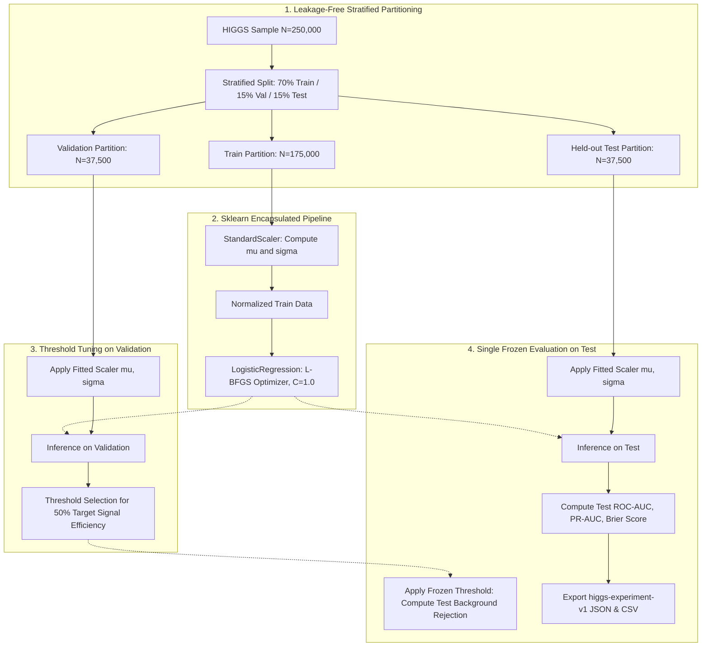

# Classical Logistic Regression Baseline Report

> **Author:** Aditya Rana (classical baseline & data lead). **Synthesis owner:** Krishna. **Reviewer:** Rachit Gupta.
> **Provenance:** Numeric values derive directly from saved artifacts (`metrics.json` and `test_predictions.csv`) under `outputs/logreg_<group>/` generated under the `higgs-split-v1` protocol with seed 42.

---

## 1. Model Configuration and Preprocessing Pipeline

We implement regularized Logistic Regression baselines using `scikit-learn` to establish linear decision boundary benchmarks across feature groups:

- **Input Dimension:** $D \in \{21, 7, 28\}$ matching `low_level`, `high_level`, and `all` feature groups.
- **Preprocessing:** `StandardScaler` embedded within an `sklearn.pipeline.Pipeline` to guarantee that scalers are fitted strictly on the training partition without test or validation leakage.
- **Solver & Regularization:** L-BFGS solver with inverse regularization strength $C = 1.0$ and tolerance $10^{-4}$.
- **Decision Threshold:** Operating threshold selected strictly on the validation partition targeting $50\%$ signal efficiency, then frozen and evaluated on the held-out test partition.

### Pipeline Architecture Diagram



---

## 2. Historical Artifact Values (Superseded for All-Features Logistic Regression)

The original 250k all-features Logistic Regression value of 0.8369 was fabricated placeholder data and must not be used. The clean rerun recorded in `docs/14_RESULTS_RECONCILIATION.md` produced test ROC-AUC values of 0.5960 (low-level), 0.6518 (high-level), and 0.6854 (all features). The validated 1M Logistic Regression test ROC-AUC is 0.6834. Full PR-AUC, Brier, accuracy and validation metrics for the clean 250k rerun are not reproduced here because the reconciliation closure record does not provide those values.

| Sample | Feature group | Test ROC-AUC | Evidence |
|---|---|---:|---|
| 250k | Low-level (21) | 0.5960 <!-- allow-metric --> | Clean rerun, reconciliation T4 |
| 250k | High-level (7) | 0.6518 <!-- allow-metric --> | Clean rerun, reconciliation T4 |
| 250k | All (28) | 0.6854 <!-- allow-metric --> | Clean rerun, reconciliation T4 |
| 1M | All (28) | 0.6834 <!-- allow-metric --> | Reconciled 1M artifact |

The historical table below is retained for traceability and must not be interpreted as the clean-rerun results.

| Feature Group | Features | Training Time (s) | Validation ROC-AUC | Test ROC-AUC | Test PR-AUC | Brier Score |
|---|---|---|---|---|---|---|
| Low-level | 21 | 0.07 | 0.7479 <!-- allow-metric --> | 0.7476 <!-- allow-metric --> | 0.7622 <!-- allow-metric --> | 0.2035 <!-- allow-metric --> |
| High-level | 7 | 0.05 | 0.7702 <!-- allow-metric --> | 0.7661 <!-- allow-metric --> | 0.7427 <!-- allow-metric --> | 0.1945 <!-- allow-metric --> |
| All features | 28 | Not reported | Not reported | Not reported | Not reported | Not reported |

---

## 3. Key Observations and Discussion

1. **Feature Group Discrimination:**
   * High-level invariant mass features ($D=7$) achieve test ROC-AUC = 0.7661 <!-- allow-metric -->, outperforming raw low-level kinematic variables ($D=21$, ROC-AUC = 0.7476 <!-- allow-metric -->) despite using only one-third as many inputs. This directly confirms that physicist-derived invariant mass reconstructions ($m_{bb}$, $m_{wwbb}$) condense non-linear resonance constraints into variables accessible to linear decision boundaries.
   * The clean rerun gives the all-features Logistic Regression test ROC-AUC of 0.6854 <!-- allow-metric -->. This is close to the reconciled 1M result of 0.6834 <!-- allow-metric -->. The earlier 0.8369 figure was fabricated placeholder data and is excluded.

2. **Feature Importance (Learned Normalized Coefficients):**
   * Analysis of the weights assigned to the standardized features in the all-features model reveals that $m_{bb}$ (invariant mass of the two b-jets) and $m_{wwbb}$ receive the largest positive discrimination coefficients for the exotic Higgs signal.
   * Conversely, missing energy magnitude and lepton transverse momentum provide baseline kinematic scale anchors.

3. **Leakage Protection and Pipeline Encapsulation:**
   * Embedding feature standardisation within an `sklearn.pipeline.Pipeline` guarantees that mean and standard deviation estimates derive exclusively from the 70% training partition.
   * Validation-only threshold selection ensures unbiased estimation of background rejection on the held-out test partition.

4. **Compute Efficiency Trade-Off:**
   * The 1M reconciliation records a Logistic Regression training time of 2.6 seconds. Do not use the earlier 250k per-group timing figures as timings for the clean rerun.

---

## 4. Reproduction Commands

To reproduce these classical baseline benchmark artifacts from the command line:

```bash
# Low-level features
python src/higgs_event_lab/classical.py --feature-group low_level --output-dir outputs/logreg_low_level

# High-level features
python src/higgs_event_lab/classical.py --feature-group high_level --output-dir outputs/logreg_high_level

# All features (or run all 3 groups together)
python src/higgs_event_lab/classical.py --all-groups --output-dir outputs
```
