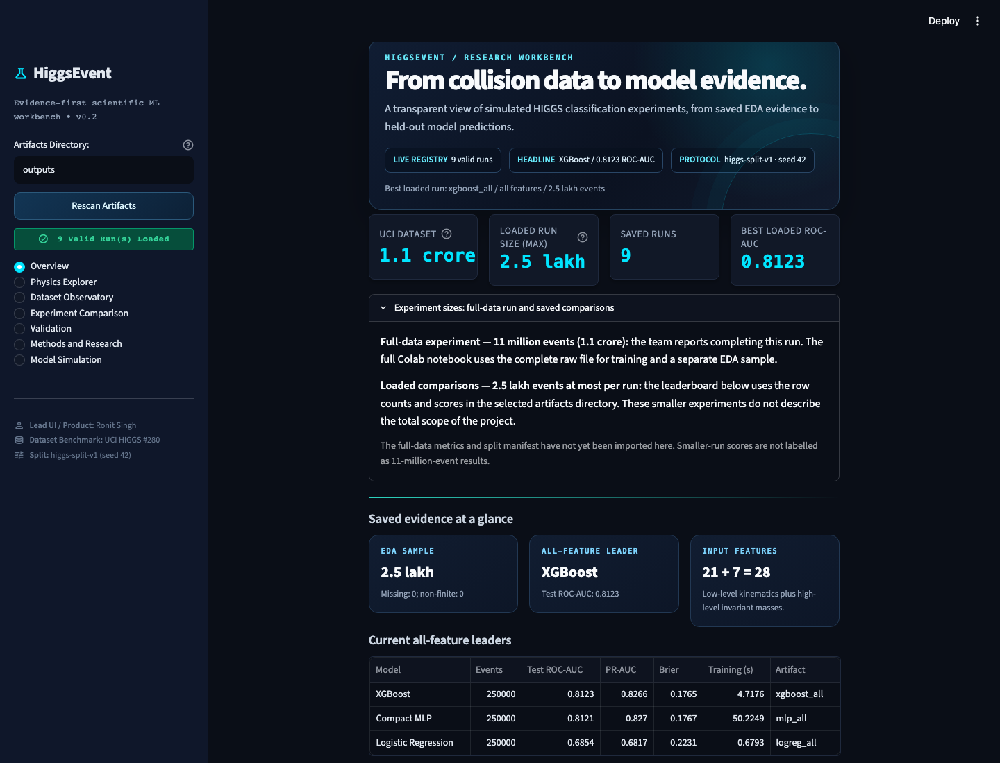

# HiggsLens: Machine-Learning Classification of Simulated HIGGS Events

**Final artifact-backed report**  
**Project team:** Saumya Mishra · Aditya Rana · Rachit Gupta · Ronit Singh · Krishna  
**Dataset:** UCI HIGGS, dataset 280  
**Source:** <https://archive.ics.uci.edu/dataset/280/higgs>  
**Generated from:** saved artifacts under `outputs/`  

> **Scientific boundary.** HIGGS is a simulated Monte Carlo benchmark. This project evaluates classification software and makes no claim of particle discovery, real-detector performance, or physical probabilities.

## 1. Executive summary

HiggsLens is a reproducible machine-learning workbench for separating simulated HIGGS signal events from simulated background events. The implementation compares two classical baselines (Logistic Regression and XGBoost) with three PyTorch networks: the mid-semester compact MLP, a deep MLP sized like Baldi et al. (2014) and a residual MLP. Each is trained on 21 low-level kinematic features, 7 high-level invariant-mass features and all 28 features, at 250k, 1M and 2.5M events.

**Main result.** At 2.5m events the Residual MLP reaches test ROC-AUC **0.8613** on all features against **0.8382** for XGBoost. <!-- allow-metric --> Given only the 21 low-level features it reaches **0.8532**, which is above XGBoost on the same features (0.7669) and above XGBoost given all 28 features. <!-- allow-metric --> The network learns from the raw kinematics what the hand-built invariant masses give the trees. The deep-network advantage on all features grows with data: +0.015 at 250k, +0.020 at 1m, +0.023 at 2.5m. The compact mid-semester MLP stays near XGBoost (0.8255 at 2.5m), which is why the mid-semester comparison looked like a tie. <!-- allow-metric -->

The dashboard registry contains **15 runs** from the 250k budget, using the `higgs-split-v1` protocol with seed 42. The strongest currently loaded artifact is **Residual MLP on `all` features**, with test ROC-AUC **0.8339**, PR-AUC **0.8531**, Brier score **0.1660**, and accuracy **0.7526**. <!-- allow-metric -->

The release benchmark trains every model with the same code, deduplicated data, split protocol and seed at every budget (Section 7.1); 278,698 duplicate events were removed from the raw file first. The older `outputs/full_colab_results.json` notebook record used a different pipeline and is kept only for traceability.

## 2. Research question and scope

The central question is whether models can learn useful separation directly from low-level event kinematics, whether high-level invariant masses provide a measurable advantage, and how model family changes discrimination, calibration and compute cost.

In scope:

- Binary classification of simulated signal/background events.
- Logistic Regression, XGBoost, the compact MLP, the deep MLP and the residual MLP.
- Low-level, high-level and combined feature groups.
- Stratified train/validation/test evaluation with saved prediction artifacts.
- Streamlit inspection of metrics, curves, thresholds and EDA evidence.

Outside scope:

- Reproducing the 2012 Higgs discovery.
- Real detector data, significance estimates or systematic-uncertainty modelling.
- Treating classifier scores as physical probabilities.

## 3. Dataset and data card

The source is the UCI Machine Learning Repository HIGGS dataset (id 280), released under CC BY 4.0. The official archive contains approximately 11 million simulated events, one binary label and 28 inputs. The notebooks download the archive directly from the UCI URL; the repository contains code and artifacts, not the raw dataset.

| Item | Verified value |
|---|---|
| Dataset | UCI HIGGS, dataset 280 |
| Raw source URL | <https://archive.ics.uci.edu/static/public/280/higgs.zip> |
| Schema | 1 label + 28 features |
| Feature groups | 21 low-level + 7 high-level + 28 combined |
| Current saved EDA rows | 250,000 |
| Signal events in saved EDA | 131,942 (52.78%) |
| Background events in saved EDA | 118,058 (47.22%) |
| Missing values | 0 |
| Non-finite values | 0 |
| Split | 70% train / 15% validation / 15% test, seed 42 |

The EDA table above describes the saved 250,000-row EDA artifact. It is a separate descriptive snapshot; the deduplicated release benchmark uses its own nested samples and per-budget class fractions recorded in `outputs/release/release_summary.json`. Do not substitute the EDA class counts for release-benchmark class fractions.

## 4. Exploratory data analysis

The EDA artifacts are generated under `outputs/eda/` and are displayed by the Dataset Observatory in Streamlit. The saved report contains feature summaries, class balance, feature distributions, group separation and correlation outputs.


The strongest saved feature correlations include `m_wbb`–`m_wwbb` (**0.895**) and `m_jj`–`m_jjj` (**0.791**). The four b-tag features have three unique values each in the saved summary and are strongly zero-inflated, which supports treating them as discrete indicators rather than smooth measurements.

## 5. Experimental protocol

The loader validates column count, numeric values, binary labels and finite feature values. A fixed seed of 42 creates the `higgs-split-v1` partition for each budget. StandardScaler is fitted on training rows only for Logistic Regression and the MLP. XGBoost uses the validated feature matrix without requiring standardisation. Validation data is used for model selection and early stopping; the release artifacts do not include a complete per-run operating-point record, so no operating threshold is quoted in this report.

Every run exports a `metrics.json` envelope and a `test_predictions.csv` file. The dashboard reads those files and never trains a model during startup.

## 6. Models

### Logistic Regression

The linear baseline uses an L-BFGS solver with `C=1.0` and a training-only StandardScaler. It provides a fast, interpretable reference for how much separation can be obtained without nonlinear interactions.

### XGBoost

Depth 8, learning rate 0.1, subsample 0.8, column subsample 0.8, histogram trees, and up to 3000 trees with early stopping after 50 rounds without improvement in validation log-loss. Tuning the number of trees on validation keeps the tree baseline strong at every budget, so the comparison with the networks is fair.

### Compact MLP (mid-semester)

Hidden widths 64 and 32, BatchNorm1d, ReLU, dropout 0.20, AdamW, learning rate 1e-3, weight decay 1e-4, batch size 1024, at most 30 epochs with validation-ROC-AUC checkpointing. About 4k parameters: a shallow network in the sense of Baldi et al.

### Deep MLP

Five hidden layers of 300 units (the size Baldi et al. found best on HIGGS) with BatchNorm, ReLU and dropout 0.10, AdamW with weight decay 1e-5 and a cosine learning-rate schedule, up to 60 epochs, early stopping after 8 epochs without validation improvement.

### Residual MLP

Four residual blocks of width 256 (BatchNorm, Linear to 512, ReLU, dropout, Linear back to 256, plus a skip connection), after Gorishniy et al. (2021). Same optimiser and stopping rule as the deep MLP. The reasoning behind both deep models is in `docs/16_WHY_DEEP_LEARNING.md`.

## 7. Current saved results

The following table is the 250k release-budget snapshot currently loaded by the dashboard. Metrics are read from the saved run artifacts; accuracy is computed at score threshold 0.5 from each run's saved test predictions. The complete 250k/1M/2.5M comparison follows in Section 7.1.

| Model | Feature group | Features | ROC-AUC | PR-AUC | Brier | Accuracy | Time (s) |
|---|---:|---:|---:|---:|---:|---:|---:|
| Residual MLP | `all` | 28 | 0.8339 | 0.8531 | 0.1660 | 0.7526 | 28.65 |
| Deep MLP (5x300) | `all` | 28 | 0.8271 | 0.8464 | 0.1693 | 0.7470 | 19.82 |
| XGBoost | `all` | 28 | 0.8188 | 0.8398 | 0.1727 | 0.7375 | 2.35 |
| Compact MLP | `all` | 28 | 0.8165 | 0.8385 | 0.1746 | 0.7368 | 12.80 |
| Residual MLP | `high_level` | 7 | 0.7945 | 0.8206 | 0.1835 | 0.7142 | 38.54 |
| Deep MLP (5x300) | `high_level` | 7 | 0.7945 | 0.8204 | 0.1836 | 0.7147 | 29.80 |
| XGBoost | `high_level` | 7 | 0.7852 | 0.8117 | 0.1873 | 0.7076 | 0.83 |
| Compact MLP | `high_level` | 7 | 0.7846 | 0.8115 | 0.1881 | 0.7037 | 12.84 |
| Residual MLP | `low_level` | 21 | 0.7716 | 0.7889 | 0.1969 | 0.7026 | 48.33 |
| Deep MLP (5x300) | `low_level` | 21 | 0.7561 | 0.7755 | 0.2001 | 0.6914 | 21.85 |
| Compact MLP | `low_level` | 21 | 0.7250 | 0.7486 | 0.2103 | 0.6659 | 13.54 |
| XGBoost | `low_level` | 21 | 0.7223 | 0.7456 | 0.2107 | 0.6647 | 2.82 |
| Logistic Regression | `all` | 28 | 0.6864 | 0.6944 | 0.2216 | 0.6460 | 0.76 |
| Logistic Regression | `high_level` | 7 | 0.6466 | 0.6314 | 0.2307 | 0.6328 | 0.32 |
| Logistic Regression | `low_level` | 21 | 0.5962 | 0.6369 | 0.2407 | 0.5703 | 0.37 |


For the classical models and the compact MLP, the 7 high-level features beat the 21 low-level ones: they need the physicists' invariant masses. The deep and residual networks reverse that once there is enough data, scoring higher on low-level features alone than on high-level features alone. Calibration is a point in XGBoost's favour: its expected calibration error stays below 0.01, while the networks sit around 0.01 to 0.03, so the network scores would need recalibration before being used as probabilities.

### 7.1 Release benchmark: 250k, 1M and 2.5M

`scripts/release_benchmark.py` removes duplicate events from the raw UCI file, draws nested seeded samples and trains all fifteen model/feature combinations at each budget with identical code, seed and `higgs-split-v1` splits. Logs and artifacts are under `outputs/release/`.

| Run | 250k ROC-AUC | 250k PR-AUC | 250k Brier | 250k train s | 1m ROC-AUC | 1m PR-AUC | 1m Brier | 1m train s | 2.5m ROC-AUC | 2.5m PR-AUC | 2.5m Brier | 2.5m train s |
|---|---:|---:|---:|---:|---:|---:|---:|---:|---:|---:|---:|---:|
| `deep_mlp_all` | 0.8271 | 0.8464 | 0.1693 | 19.8 | 0.8474 | 0.8660 | 0.1591 | 136.3 | 0.8591 | 0.8769 | 0.1524 | 425.5 |
| `deep_mlp_high_level` | 0.7945 | 0.8204 | 0.1836 | 29.8 | 0.7964 | 0.8219 | 0.1826 | 166.5 | 0.7987 | 0.8245 | 0.1817 | 430.3 |
| `deep_mlp_low_level` | 0.7561 | 0.7755 | 0.2001 | 21.8 | 0.8141 | 0.8295 | 0.1752 | 175.1 | 0.8396 | 0.8548 | 0.1622 | 430.6 |
| `logreg_all` | 0.6864 | 0.6944 | 0.2216 | 0.8 | 0.6838 | 0.6945 | 0.2222 | 2.9 | 0.6842 | 0.6951 | 0.2222 | 5.5 |
| `logreg_high_level` | 0.6466 | 0.6314 | 0.2307 | 0.3 | 0.6473 | 0.6334 | 0.2307 | 1.1 | 0.6471 | 0.6327 | 0.2307 | 2.5 |
| `logreg_low_level` | 0.5962 | 0.6369 | 0.2407 | 0.4 | 0.5939 | 0.6350 | 0.2411 | 1.3 | 0.5938 | 0.6353 | 0.2410 | 2.9 |
| `mlp_all` | 0.8165 | 0.8385 | 0.1746 | 12.8 | 0.8230 | 0.8442 | 0.1717 | 49.5 | 0.8255 | 0.8465 | 0.1705 | 124.2 |
| `mlp_high_level` | 0.7846 | 0.8115 | 0.1881 | 12.8 | 0.7863 | 0.8132 | 0.1877 | 41.2 | 0.7882 | 0.8146 | 0.1868 | 124.5 |
| `mlp_low_level` | 0.7250 | 0.7486 | 0.2103 | 13.5 | 0.7382 | 0.7600 | 0.2068 | 50.1 | 0.7448 | 0.7646 | 0.2048 | 112.2 |
| `resnet_mlp_all` | 0.8339 | 0.8531 | 0.1660 | 28.6 | 0.8506 | 0.8689 | 0.1572 | 162.8 | 0.8613 | 0.8788 | 0.1513 | 493.7 |
| `resnet_mlp_high_level` | 0.7945 | 0.8206 | 0.1835 | 38.5 | 0.7966 | 0.8222 | 0.1826 | 224.4 | 0.7989 | 0.8248 | 0.1816 | 560.5 |
| `resnet_mlp_low_level` | 0.7716 | 0.7889 | 0.1969 | 48.3 | 0.8203 | 0.8355 | 0.1726 | 225.2 | 0.8532 | 0.8687 | 0.1553 | 560.2 |
| `xgboost_all` | 0.8188 | 0.8398 | 0.1727 | 2.4 | 0.8302 | 0.8505 | 0.1671 | 10.0 | 0.8382 | 0.8578 | 0.1632 | 28.6 |
| `xgboost_high_level` | 0.7852 | 0.8117 | 0.1873 | 0.8 | 0.7897 | 0.8153 | 0.1855 | 2.6 | 0.7921 | 0.8178 | 0.1845 | 6.6 |
| `xgboost_low_level` | 0.7223 | 0.7456 | 0.2107 | 2.8 | 0.7478 | 0.7679 | 0.2018 | 10.4 | 0.7669 | 0.7842 | 0.1946 | 35.4 |

| Check | 250k | 1m | 2.5m |
|---|---|---|---|
| Rows | 250000 | 1000000 | 2500000 |
| Signal fraction | 0.54319 | 0.544 | 0.54377 |
| Split indices disjoint | True | True | True |
| Splits cover every row | True | True | True |
| Duplicate events in sample | 0 | 0 | 0 |
| Events shared by train and test | 0 | 0 | 0 |

Determinism: two CPU trainings of the all-feature MLP with seed 42 (3 epochs) differ by at most 0.00e+00 in any test probability (identical).

Environment: Python 3.13.16, torch 2.11.0+cu130, GPU Tesla T4, Linux-6.18.55+-x86_64-with-glibc2.39. Run started 2026-11-14 17:22:17 UTC.

## 8. Operating-point analysis

The release metric envelopes record validation-selected operating points for Logistic Regression and XGBoost. The three neural-network families do not contain an `operating_point` record, so their thresholds and efficiencies are unavailable and are not inferred. Thresholds below are selected on validation data for a target signal efficiency of 50%; test metrics are then evaluated once at the frozen threshold.

| Budget | Model | Validation threshold | Validation signal efficiency | Validation background rejection | Test signal efficiency | Test background rejection |
|---|---|---:|---:|---:|---:|---:|
| 250k | Logistic Regression | 0.5940 | 50.00% | 73.33% | 50.44% | 74.13% |
| 250k | XGBoost | 0.7322 | 50.00% | 90.30% | 49.22% | 90.48% |
| 1M | Logistic Regression | 0.5969 | 50.00% | 74.33% | 50.25% | 73.84% |
| 1M | XGBoost | 0.7494 | 50.00% | 91.10% | 50.11% | 91.18% |
| 2.5M | Logistic Regression | 0.5963 | 50.00% | 74.05% | 50.13% | 73.95% |
| 2.5M | XGBoost | 0.7562 | 50.00% | 91.85% | 49.82% | 91.89% |

The dashboard's interactive threshold workbench can explore alternative cutoffs, but any model-selection threshold must be chosen on validation data and frozen before test evaluation. Background rejection is a benchmark operating metric, not a discovery significance.

## 9. Dashboard integration

Launch the application with:

```bash
streamlit run streamlit_app.py
```

The dashboard now uses:

- `outputs/*/metrics.json` and `test_predictions.csv` for experiment comparison and validation plots.
- `outputs/eda/summary.json` and `feature_summary.csv` for Dataset Observatory metrics.
- Saved EDA images for class balance, distributions and correlation views.
- Genuine MLP training history when it exists in the artifact envelope.

The app reports **15 valid runs** and skips non-run folders such as `outputs/eda/` and `outputs/model_weights/` during artifact discovery.



## 10. Testing and reproducibility

`python -m pytest -q` runs the unit and integration suite, and the GitHub Actions workflow runs it on every push. The release benchmark was run end to end on Kaggle against the full 11M-row UCI file (Section 7.1), covering sampling, split-integrity checks, all fifteen model/feature-group trainings per budget and the determinism check. The raw dataset and model binaries stay out of version control. `scripts/release_benchmark.py` regenerates everything from the raw file.

## 11. Limitations and validity threats

1. The benchmark is simulated and does not represent real detector data.
2. The benchmark class balance is approximately 53/47, unlike a real rare-event search.
3. Results use one seed per budget, so run-to-run variance across seeds is not measured.
4. Training time depends on the hardware recorded in Section 7.1 and is only comparable within one run.
5. The largest budget is 2.5M events; at that size several deep runs reached the 60-epoch cap, so they were still improving and the network numbers are, if anything, conservative.

## 12. Conclusion

The release benchmark shows that the deep and residual networks outperform validation-tuned XGBoost on all 28 features at each of the three tested sample budgets. At 2.5M events, the residual MLP reaches test ROC-AUC 0.8613 versus 0.8382 for XGBoost; on low-level features alone it reaches 0.8532 versus 0.7669 for XGBoost. These results support the benchmark-specific claim that deep networks can learn useful structure from low-level kinematics. XGBoost remains substantially faster and has lower expected calibration error in the reported runs. This is a single-seed simulated-data benchmark, not evidence of real-detector performance or particle discovery. The Streamlit dashboard presents saved experiment artifacts and must retain the same scientific limitations.

## References

1. P. Baldi, P. Sadowski and D. Whiteson, “Searching for exotic particles in high-energy physics with deep learning,” *Nature Communications*, 5, 4308, 2014. <https://www.nature.com/articles/ncomms5308>
2. D. Whiteson, “HIGGS,” UCI Machine Learning Repository, dataset 280. <https://archive.ics.uci.edu/dataset/280/higgs>
3. T. Chen and C. Guestrin, “XGBoost: A scalable tree boosting system,” KDD, 2016.
4. A. Paszke et al., “PyTorch: An imperative style, high-performance deep learning library,” NeurIPS, 2019.

## Appendix: artifact paths

- `outputs/eda/summary.json`
- `outputs/eda/feature_summary.csv`
- `outputs/eda/feature_distributions.png`
- `outputs/eda/correlation_heatmap.png`
- `outputs/release/release_summary.json`
- `outputs/release/250k/*/metrics.json`, `outputs/release/1m/*/metrics.json`, `outputs/release/2.5m/*/metrics.json`
- `outputs/mlp_*/metrics.json`
- `outputs/logreg_*/metrics.json`
- `outputs/xgboost_*/metrics.json`
